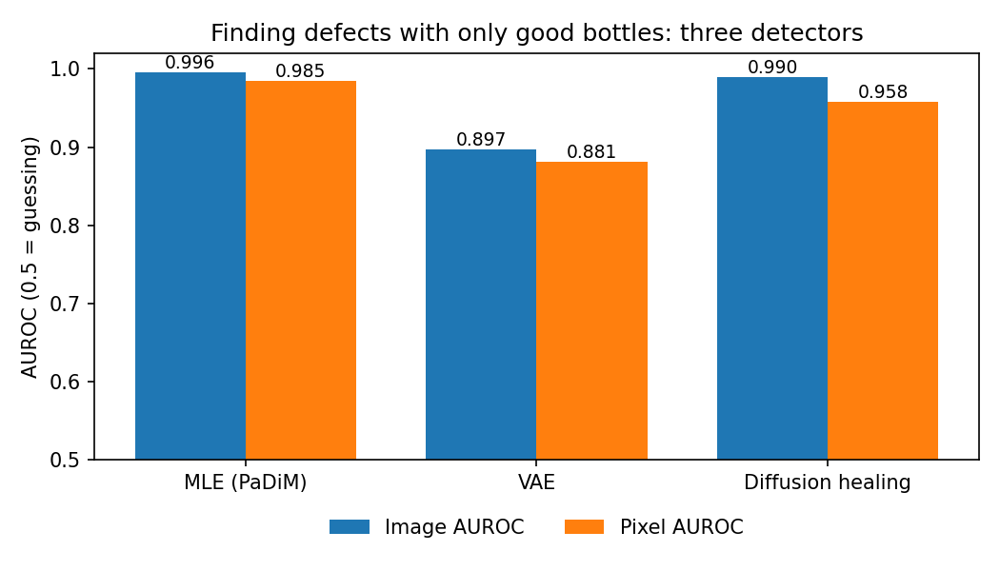
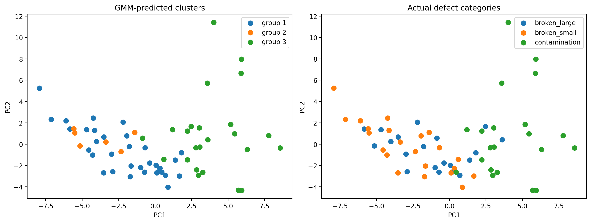
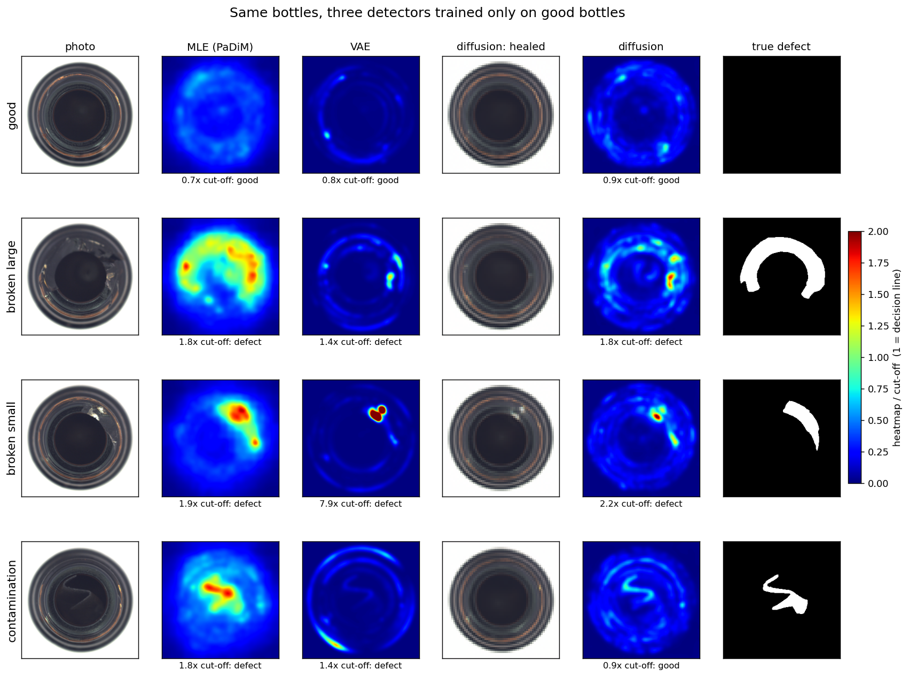
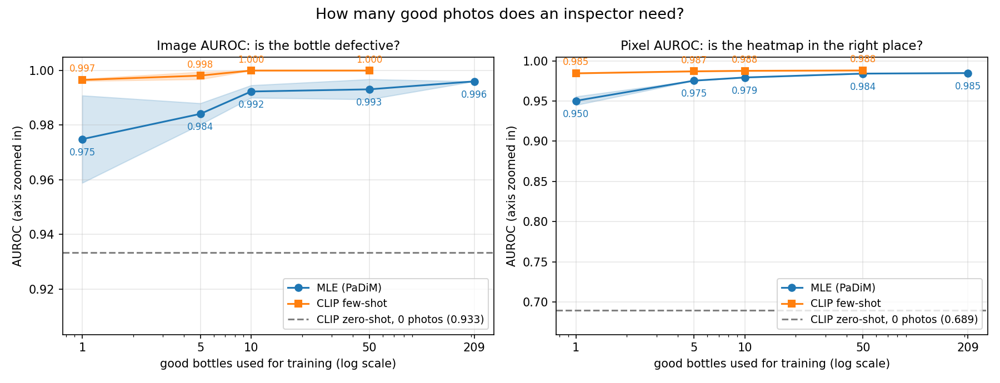
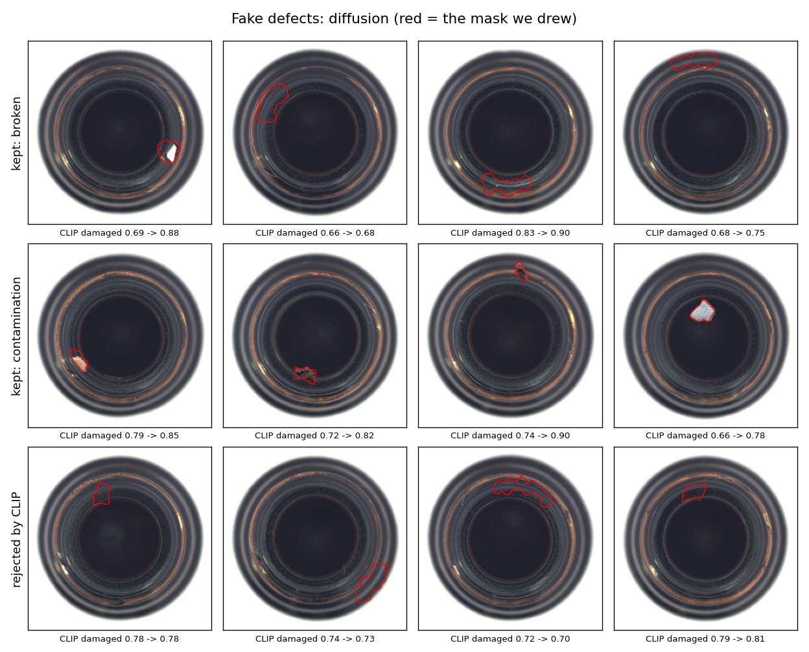
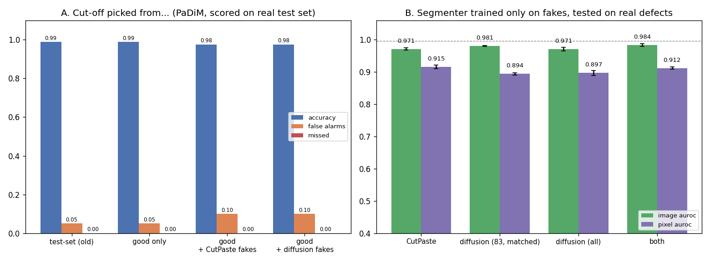

# Defect Inspector: finding defects using only good parts

Generative AI course project (Atria University). We train three detectors **only on
photos of good bottles** (MVTec AD, bottle category). Each one learns what "normal"
looks like and returns a heatmap of anything unusual, so it can find defects it has
never seen. We score all three the same way and compare them.

## Results

83 test bottles: 20 good, 63 defective. Training used only the 209 good bottles.

| Detector | Course topic | Image AUROC | Pixel AUROC | Correct at cut-off |
|---|---|---|---|---|
| MLE (PaDiM) | Likelihood, MLE, Gaussians | **0.996** | **0.985** | 98.8% |
| VAE | Autoencoders, latent space, KL | 0.897 | 0.881 | 86.7% |
| Diffusion healing (t = 50) | Forward and reverse diffusion | 0.990 | 0.958 | 96.4% |

Image AUROC: is the bottle defective? Pixel AUROC: is the heatmap in the right place?
0.5 = guessing, 1.0 = perfect. Per-defect-type scores are in
[results/results_table.md](results/results_table.md).

**Defect types without labels** (Shruti, [detectors/gmm.ipynb](detectors/gmm.ipynb)): a Gaussian Mixture Model groups
the 63 defective test bottles into 3 types, using PaDiM features of each bottle's most unusual region plus the
defect's size and peak score. ARI **0.387** against the true types (0 = random, 1 = perfect; 0.282 without the size
features). Contamination forms its own group; large and small breaks mix.

## Going further: few photos, CLIP, and fake defects

**How many good photos does it need?** ([few_shot.py](few_shot.py), [clip_detector.py](detectors/clip_detector.py))
PaDiM fitted on k random good bottles (3 draws each), and CLIP (ViT-B/16) remembering the patches of k good bottles:

| Good photos | PaDiM image / pixel | CLIP image / pixel |
|---|---|---|
| 0 (CLIP reads text: "damaged bottle") | | 0.933 / 0.689 |
| 1 | 0.975 / 0.950 | **0.997 / 0.985** |
| 10 | 0.992 / 0.979 | **1.000 / 0.988** |
| all 209 | 0.996 / 0.985 | |

With CLIP, **one good photo is enough** to match PaDiM trained on all 209.

**Fake defects** ([synthetic.py](synthetic.py), [make_diffusion_defects.py](make_diffusion_defects.py)).
Real defect photos are rare, so we make them: draw a defect mask on a good bottle and fill it either by
CutPaste (pixels from a rotated, brightness-shifted bottle) or by Stable Diffusion inpainting
("broken glass...", "a dark piece of debris..."), zoomed in so the defect isn't "healed" away.
CLIP keeps a fake only if it looks more damaged than the bottle it came from:
CutPaste 83/150 kept, diffusion 162/300 (75 min on a 4 GB laptop GPU).

**Using the fakes** ([use_fakes.py](use_fakes.py)). No real defect photo is used for anything but the final score.

| Cut-off picked from (PaDiM fitted on 150 good bottles) | Accuracy on real test set | False alarms | Missed |
|---|---|---|---|
| the test set itself (old way, cheating) | 98.8% | 5% | 0% |
| 59 held-out good bottles only | **98.8%** | 5% | 0% |
| good + CutPaste / diffusion fakes | 97.6% | 10% | 0% |

So the 98.8% holds up when the cut-off is picked honestly.

A **segmenter trained only on fakes** (a small conv head on frozen ResNet18 features), tested on the real defects:
CutPaste fakes 0.971 / 0.915, diffusion fakes (same count) **0.981** / 0.894, both **0.984 / 0.912** (image / pixel AUROC, 3 seeds).
It never saw a real defect. Diffusion fakes are better for "is it defective?", CutPaste for "where?".
It does not beat PaDiM, and with only 10 good photos it drops to 0.92.

**Honest notes**
- The cut-offs in the first table, and the diffusion noise level, were chosen on the test set.
  For PaDiM, picking the cut-off from held-out good bottles instead gives the same accuracy (table above).
  AUROC does not depend on a cut-off.
- One category only (bottle), 209 training images, 20 good test bottles (so 5% = one bottle).

## What's in the repo

| File | What it does | Owner |
|---|---|---|
| `data.py` | Loads MVTec bottle: images, labels, masks, defect types, all at 256x256 | Sohail |
| `evaluate.py` | Shared scoring: image AUROC, pixel AUROC, cut-off, accuracy | Sohail |
| `detectors/padim.py` | Detector 1: MLE, a Gaussian per image patch on ResNet18 features | Sohail |
| `detectors/vae.ipynb` | Detector 2: VAE training notebook (Colab) | Shruti |
| `detectors/vae.py` | Loads the trained `vae.pt` and makes VAE heatmaps | Shruti / Sohail |
| `detectors/diffusion_healing.ipynb` | Detector 3: DDPM training, healing, noise-level tuning (Colab) | Raju |
| `detectors/diffusion.py` | Loads the trained DDPM and heals bottles on a CPU (~3 s each) | Raju / Sohail |
| `few_shot.py` | PaDiM with 1 to 209 good photos | Sohail |
| `detectors/clip_detector.py` | Detector 4: CLIP zero-shot (text only) and few-shot | Sohail |
| `synthetic.py` | Fake defects: masks, CutPaste, CLIP filter, gallery | Sohail |
| `make_diffusion_defects.py` | Fake defects with Stable Diffusion inpainting (GPU) | Sohail |
| `use_fakes.py` | Honest cut-offs and a segmenter trained only on fakes | Sohail |
| `detectors/gmm.ipynb` | Extra: GMM groups defects into types without labels (ARI) | Shruti |
| `demo.py` | Demo app: upload a bottle, see all four heatmaps and the verdict | Sohail |
| `make_figures.py` | Results table, chart and figures in `results/` | Sohail |
| `results/` | Scores (`*.json`), tables and figures | everyone |

**The one rule:** every detector turns one 256x256 RGB image into a 256x256 heatmap,
higher = more likely a defect. That's what lets one scoring script and one demo work
with all three.

## How to reproduce

**1. Install** (Python 3.10+):

    pip install numpy pillow scipy scikit-learn matplotlib torch torchvision

**2. Data.** Not stored here (licence: CC BY-NC-SA 4.0, and size). Get the bottle
category from the team Drive or the MVTec website and put it in `data/bottle/`, so
that `data/bottle/train/good/` exists. Check:

    python data.py            # prints "209 train, 83 test", saves results/preview.png

**3. Detectors.** Run from the repo root.

    python -m detectors.padim                  # ~30 s on a CPU; saves results/padim.json and heatmaps
    python -m detectors.vae path/to/vae.pt     # VAE heatmaps from the trained model (vae.pt is in the team Drive)

    python -m detectors.diffusion              # heals all 83 test bottles on a CPU (~4 min), prints scores

The official diffusion numbers come from Raju's Colab run: `detectors/diffusion_healing.ipynb`
exports `diffusion_heatmaps.npz`, which goes into `results/` for the figures. A CPU run uses
different random noise, so it scores very slightly differently (0.989 / 0.956).
Training notebooks for the VAE and the DDPM are in `detectors/`.

**4. Going further** (CLIP downloads ~600 MB; diffusion fakes need a GPU and diffusers):

    python few_shot.py                         # PaDiM with k good photos -> few_shot.json, fig_few_shot.png
    python -m detectors.clip_detector          # CLIP zero/few-shot -> clip.json (then re-run few_shot.py for the plot)
    python synthetic.py cutpaste && python synthetic.py filter data/synthetic/cutpaste
    python make_diffusion_defects.py --n 300 && python synthetic.py filter data/synthetic/diffusion
    python use_fakes.py                        # -> fakes.json, fig_use_fakes.png (~5 min)

**5. Tables and figures:**

    python make_figures.py    # results_table.md, fig_results.png, fig_padim.png, fig_compare.png

**Self-tests:** `python data.py --selftest` and `python evaluate.py --selftest`.

## Demo app

    pip install gradio diffusers transformers
    python demo.py            # http://127.0.0.1:7860 (starts in ~40 s); add --share for a public link
    python demo.py --backup   # saves results/demo_backup.png, a static copy in case the live demo fails

Upload a bottle photo or pick one of four examples. You get a verdict from each detector
(its score as a multiple of its cut-off), the four heatmaps and the diffusion-healed bottle.
CLIP is shown only 10 good bottles; its cut-off is the highest score among 50 other good bottles.
Needs `data/bottle/` and, from the team Drive, `models/vae.pt` and `models/ddpm_bottle_ema/`.

## Use a detector in your own code

    from data import load_mvtec
    from evaluate import run
    from detectors.padim import PaDiM

    d = load_mvtec()
    model = PaDiM().fit(d["train_images"])
    run(model.detect, name="padim")            # prints scores, saves results/padim.json

Large files are not in Git: the dataset (`data/`), the trained models (`models/vae.pt`,
`models/ddpm_bottle_ema/`) and the heatmap exports (`results/*.npy`, `results/*.npz`).
